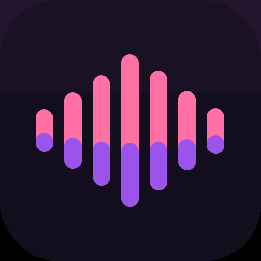

<!-- Cadence README: product-facing overview -->

<div align="center">
  

  # Cadence

  ### Swipe to find your sound.

  **Music discovery that learns what feels like *you*.**

  Explore tracks one swipe at a time, preview what catches your ear, and build a taste profile that gets sharper with every decision.

  <p>
    <a href="https://cadence.edgeone.dev/"><strong>Open Cadence ↗</strong></a>
    &nbsp; · &nbsp;
    <a href="#how-it-works">How it works</a>
    &nbsp; · &nbsp;
    <a href="#features">Features</a>
  </p>

  <p>
    <a href="https://github.com/harshit-nimje/cadence/actions/workflows/validate.yml"></a>
    
    
    
  </p>
</div>

---

## What is Cadence?

Most music apps start with a search box, a massive catalogue, or a playlist someone else made.

**Cadence starts with your instincts.**

Swipe through music, listen to previews, and react honestly. Each like, dislike, and skip contributes a little more evidence about your taste. Cadence uses those signals to shape its recommendations, surface moods that fit, and show you how your musical identity evolves.

It is designed to make discovering music feel less like managing a library and more like finding a song you didn't know you needed.

## Features

### 🎧 Discover by feel
- A swipeable, layered deck of tracks with artwork, artist details, and audio previews.
- Left to dislike, right to like, down to skip.
- Undo recent decisions, shuffle into a fresh deck, and play or pause previews.
- Subtle motion, tactile feedback, animated waveforms, and artwork-led visuals.

### 🧠 A taste profile that learns
Cadence doesn't rely on a static list of genres. Its ranking engine blends multiple signals from your interactions, including:

- **Genre affinity** — what you tend to come back to.
- **Artist affinity** — the artists your reactions favour.
- **Sound characteristics** — energy, valence, acousticness, and danceability.
- **Era** — the release periods you lean toward.
- **Track-title keywords** — recurring patterns in the music you respond to.
- **Exploration** — a little room for unexpected finds, even as recommendations become more personal.

The goal is to balance familiar territory with the occasional surprise. The profile, recent swipes, and taste insights make that learning visible rather than mysterious.

### 🌊 Eight moods, your taste
Explore recommendations around eight moods—**Chill, Focus, Workout, Party, Sad hours, Feel-good, Wind down, and Nostalgic**.

Mood scoring combines each mood's sound targets and preferred genres with your personal taste profile, so the result is more than a generic playlist label.

### ✨ More reasons to come back
- **For You:** tracks ranked against your evolving taste.
- **Mystery:** a music-guessing game with limited guesses, scoring, and streaks.
- **Daily pick:** a featured track with daily progress and streak mechanics.
- **Taste insights:** genre leanings, sound-profile bars, recently liked tracks, and recommendation context.
- **Taste import:** seed your profile using pasted track lists, text, supported CSV data, or accessible Spotify playlists.
- **Export and reset:** keep a portable copy of your taste data or start fresh.

### 🎵 Optional Spotify connection
Connect your own Spotify app configuration to unlock supported features, including:

- Seeding recommendations from accessible top artists and tracks.
- Saving tracks to your Spotify library.
- Importing supported playlists.
- Creating private playlists from mood recommendations.

Spotify features depend on your permissions, account eligibility, developer-dashboard settings, and current API access rules. Cadence uses the Authorization Code with PKCE flow; it does not need a Spotify Client Secret in the browser.

### ☁️ Optional account sync
The current web app includes Supabase-backed accounts and taste-profile syncing, allowing a signed-in profile to be saved and restored across sessions and devices when the configured backend and database policies permit it.

Cadence remains useful without signing in: the core taste state is stored locally in the browser.

## How it works

1. **Start exploring.** Cadence begins with a small seeded collection, so you can start without connecting an account.
2. **React to tracks.** Likes, dislikes, and skips update the taste signals.
3. **Get a more personal mix.** Unseen tracks are scored against genre, artist, sound, era, and keyword preferences, with some exploration retained.
4. **Explore in context.** For You, Moods, Daily Pick, and Mystery give you different ways to discover or revisit music.
5. **Keep your progress.** Your profile persists locally, with optional account sync and export.

## The look and feel

Cadence uses a deep plum background, warm near-white text, muted lavender details, and two deliberate feedback accents: pink for likes and soft blue for dislikes. Oversized artwork and stacked cards put the music first; restrained surfaces and fluid transitions keep the interface from feeling like a dashboard.

The visual language is intentionally tactile, atmospheric, and playful—not a clone of a conventional streaming service.

## Try it

**Live app:** [cadence.edgeone.dev](https://cadence.edgeone.dev/)

Cadence is a browser-first experience designed for mobile use. You can open the live site in a mobile browser and add it to your home screen where your browser supports Progressive Web App installation.

### Run locally

You only need a static HTTP server for the core experience.

```bash
git clone https://github.com/harshit-nimje/cadence.git
cd cadence
python -m http.server 8000
```

Open [http://127.0.0.1:8000](http://127.0.0.1:8000).

> Don't open `index.html` directly as a `file://` URL. Secure-context features such as OAuth and service workers require an appropriate local or HTTPS origin. Spotify's redirect URI must exactly match the one registered in your Spotify developer dashboard.

### Connect Spotify

1. Create an app in the [Spotify Developer Dashboard](https://developer.spotify.com/dashboard/).
2. Configure the Web API and register the exact HTTPS origin/redirect URI used by your Cadence instance.
3. Add the Spotify account you're testing with to User Management if your app is subject to development-mode allowlisting.
4. In Cadence, open **Taste → Connect Spotify**, enter your Client ID, and accept the requested permissions.

Spotify policies, account requirements, API access, and development-mode limits can change. If a feature returns an authorization or permission error, check the dashboard settings and Spotify's current documentation.

### Account sync

Account sign-in and cross-device sync require the configured Supabase project to be reachable and its authentication and row-level security policies to permit the intended operations. Keep any privileged backend credentials out of client-side code. A public browser key is not a substitute for database access policies.

## Under the hood

| Part | Implementation |
|---|---|
| Interface | HTML, CSS, and vanilla JavaScript |
| Music discovery | Seeded tracks + iTunes Search API |
| Audio | Preview clips where the catalogue provides them |
| Taste engine | Client-side scoring and feedback model |
| Spotify | Spotify Web API + Authorization Code with PKCE |
| Accounts and sync | Supabase Auth and profile storage |
| Installable web shell | Web manifest + service worker |
| Production hosting | EdgeOne Pages |

The current web implementation intentionally keeps its core recommendation logic client-side. External catalogue search, audio previews, Spotify, and account sync need network access and may be subject to provider limits.

## Project structure

```text
.
├── index.html                 # Current web app: UI, styles, and application logic
├── manifest.webmanifest       # PWA metadata and install icons
├── sw.js                      # Cache-first shell/offline fallback behavior
├── icons/
│   ├── icon.svg
│   ├── icon-192.png
│   └── icon-512.png
├── .well-known/
│   └── assetlinks.json        # Android Digital Asset Links for the TWA package
└── .github/workflows/
    ├── validate.yml           # Static/PWA configuration checks
    ├── android.yml            # Existing optional TWA build workflow
    └── deploy-edgeone.yml     # Manual deployment fallback
```

The root project is currently the web application. The existing Android workflow builds a **Trusted Web Activity (TWA)** wrapper; it is not a native Compose implementation. A future Kotlin/Jetpack Compose client should be treated as a separate native implementation that reuses Cadence's product behavior and visual language rather than wrapping this HTML.

## Current scope and limitations

- Music playback uses preview URLs when they are available; Cadence is not a replacement for a full-track streaming subscription.
- Catalogue availability and artwork depend on the upstream search results.
- Spotify capabilities depend on current API permissions and account configuration.
- Cloud sync depends on Supabase connectivity and correct access policies.
- Offline support is for the app shell and cached local state; fresh search results, remote artwork, previews, Spotify, and cloud sync still require connectivity.

## Product principles

- **Taste over endless scrolling.** Every interaction should help narrow the space of possible music.
- **Exploration over repetition.** Personalization should not eliminate discovery.
- **Explainable enough to trust.** Surface the signals and history behind the evolving profile.
- **Local-first by default.** The basic discovery loop should work before account setup.
- **Motion with a purpose.** Animation should make interactions feel clear and satisfying, not get in the way.

## Contributing and feedback

Cadence is an evolving product. If you find a bug or have an idea that fits its direction, open a [GitHub issue](https://github.com/harshit-nimje/cadence/issues) with the steps to reproduce it, the screen involved, and what you expected to happen.

For code changes, keep the experience mobile-first, preserve the visual system, and avoid replacing working product logic with placeholder interactions.

---

<div align="center">

**Find your next favourite. One swipe at a time.**

[Open Cadence](https://cadence.edgeone.dev/) · [View source](https://github.com/harshit-nimje/cadence)

</div>
